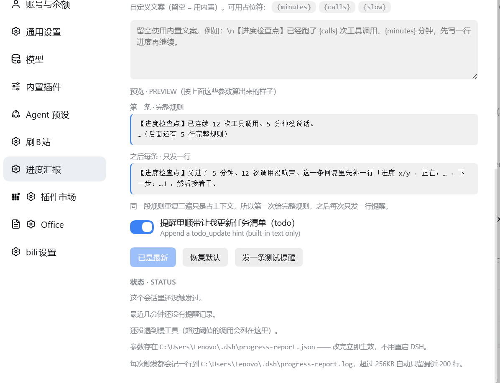

# dsh-progress-report

**English** · A DSH plugin that makes an agent **report progress while a long task is running**, instead of going silent for twenty minutes and then handing you a finished result.

It works from the host side: after every tool call the plugin checks a timer, and once the interval is up it injects a one-line progress notice into the model's next step. The model cannot "forget" it, and context compaction cannot eat it.

```bash
dsh plugin --profile desktop add dsh-progress-report
```

Then open **设置 › 进度汇报** (Settings › Progress report) and press **发一条测试提醒** — you should see a notice arrive in the conversation immediately.

---

**中文** · 一个 DSH 插件：让 AI 做长任务时**按时间/次数强制汇报进度**，而不是闷头干二十分钟、最后扔给你一个成品。

机制在宿主侧：每次工具调用结束后检查计时器，到点就往模型下一步的输入里塞一条进度提醒。模型无法"忘记"它，上下文压缩也吃不掉它。

```bash
dsh plugin --profile desktop add dsh-progress-report
```

装完打开 **设置 › 进度汇报**，点一下 **发一条测试提醒** —— 对话里应该立刻收到一条提醒。



---

## 为什么不用 AGENTS.md

在 `AGENTS.md` 里写"每 10 分钟汇报一次"是靠模型自觉：它只在文件变化时被注入一次，之后会被压缩掉，而且完全拦不住"连续 30 次工具调用一句话不说"。本插件在 `tools/post-execute` 上强制插入，与模型自觉、上下文长度都无关。

## 它什么时候提醒

三个条件谁先满足都算：

| 条件 | 默认 | 说明 |
| --- | --- | --- |
| `intervalMinutes` | 10 分钟 | 距上一次汇报的时间 |
| `maxToolCalls` | 12 次 | 连续这么多次工具调用没汇报（另受 `minGapMinutes` 约束，默认 3 分钟） |
| 慢工具 | `slowToolSeconds` 60 秒 | 单个工具跑得久，结束时会补一句"刚才那个调用跑了多久" |
| 定时兜底 | 每 30 秒扫一次 | 到点就直接把提醒排进下一步输入，**不依赖下一次工具调用** —— 覆盖"一直思考不调工具"和"单个超长命令"这两种沉默 |
| `minToolCalls` | 2 次 | 少于这么多次调用不打断，免得一句话长思考也被点名 |

一次真人用户消息会重置计时器；**模型自己说了可见文字也算汇报**（监听 `assistant-stream` 的 `text-delta`），所以不会出现"刚汇报完三分钟又被提醒"。内部思考（`reasoning-delta`）不算，用户看不见。子代理（`workflow` / `subagent` 起的）不会被提醒；闲置超过 5 分钟的会话不会被定时器叫醒。

## 提醒长什么样

注入的是一条 `form: "notice"` 的消息 —— **不是用户发言**，不会污染对话历史。

**第一条**给完整规则：

```
【进度检查点】已连续 12 次工具调用、10 分钟没说话。

不要停手，也别单独发一条纯文字消息：在接下来这条回复里，先写一行进度，
紧接着把原本要调的工具一起发出去。

进度 x/y · 已完成：… · 正在：… · 下一步：… · 风险：无 / <具体风险>
```

**之后每条只发一行**（同一段规则重复三遍只会占上下文）：

```
【进度检查点】又过了 10 分钟、12 次调用没吭声。这一条回复里先补一行
「进度 x/y · 正在：… · 下一步：…」，然后接着干。
```

文案可以整段替换：设置页里 `template` 留空用内置，填了就整段由你写，支持 `{minutes}` `{calls}` `{slow}` 三个占位符；`lang` 可选 `auto` / `zh` / `en`。设置页有**实时预览**，改参数时直接看到两种形态长什么样。

## 在哪调

设置页（**设置 › 进度汇报**）或 `~/.dsh/progress-report.json`，两个是同一个文件。改完下一次工具调用就生效，不用重启。

| 字段 | 默认 | 说明 |
| --- | --- | --- |
| `enabled` | `true` | 总开关 |
| `intervalMinutes` | `10` | 间隔（0.5–1440） |
| `maxToolCalls` | `12` | 次数兜底（0 = 关闭） |
| `minGapMinutes` | `3` | 两次提醒的最小间隔 |
| `minToolCalls` | `2` | 触发所需的最少调用次数 |
| `mentionTodo` | `true` | 内置文案里是否附带"顺手更新 todo"（自定义文案时不生效） |
| `lang` | `auto` | 提醒语言 |
| `template` | `""` | 自定义提醒全文 |
| `slowToolSeconds` | `60` | 慢工具阈值 |

数值超出范围会被**钳到边界**并在设置页回显（"从 0.1 调整为 0.5，范围 0.5–1440"），不会悄悄跳回默认值。

## 排查

每次触发都会往 `~/.dsh/progress-report.log` 追加一行（超过 256KB 自动只留最近 200 行）：

```
16:42:07 fire reason=时间到 gap=10min calls=12
16:48:31 test delivered=true agent=yes
```

设置页的「状态」区会显示最近 6 次提醒（时间、原因、间隔、**按会话区分**）、以及遇到的慢工具。点 **发一条测试提醒** 可以随时验证整条链路通不通。

## 和类似插件的区别

同一个方向上已经有两个条目：

| | 触发 | 模型怎么收到 | 留痕 |
| --- | --- | --- | --- |
| `dsh-progress-nudge` | 连续 N 轮只调工具 | 可见的**用户消息** | 无 |
| `dsh-narrator` | 静默时长（可调最小间隔、可换文案） | 可见的**用户消息**，另镜像到浮窗 | 无 |
| **本插件** | **墙钟间隔** + 调用次数兜底 + 慢工具 + 30 秒定时器 | `form:"notice"` 经 `additionalContexts`，**不算用户发言** | 触发日志 + 设置页状态（按会话） |

实际差别在注入形态：notice 直接送到模型，但不会在对话里冒充用户说过什么，也就不会被后来的压缩当成"用户说过这句话"。

## 开发与测试

```bash
npm test          # node --test test/*.test.mjs，17 条，不需要装任何依赖
npm run test:clean # 把 files 白名单复制到空目录再加载 = 模拟"用户装了个包"
npm run check     # 两个入口文件的语法检查
```

测试覆盖：触发阈值、计数归零、真人发话重置、**模型说话即清零**、**推理不算汇报**、**首条完整/后续一行**、自定义文案不区分首条、文案占位符、慢工具点名、子代理不提醒、越界钳位、非法值回默认、中英双语、存档往返、首次播种。CI 在 `.github/workflows/ci.yml`（node 22/24 矩阵 + 零依赖断言 + 上面三条一起跑）。

插件不绑 profile：路径全部来自 `DSH_HOME`，desktop 与 bili-duty 用的是同一份代码，只是各自的 `progress-report.json` 与日志分开。

## 变更记录

见 [CHANGELOG.md](./CHANGELOG.md)。

## 卸载

```bash
dsh plugin --profile desktop remove dsh-progress-report
```

配置文件与日志留在 `~/.dsh/` 下，手动删掉即可。插件卸载后设置页那一栏随之消失。

## 许可

MIT
